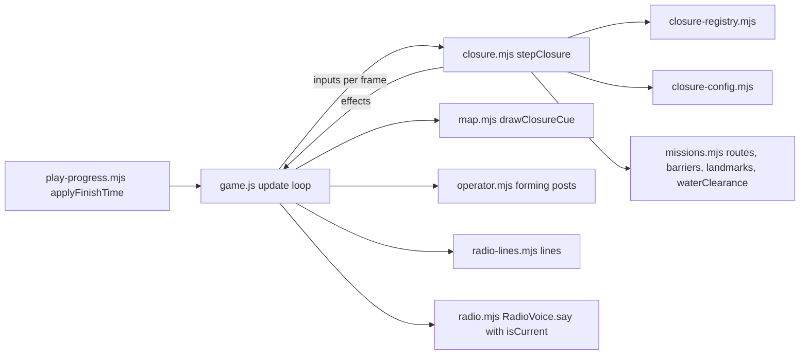
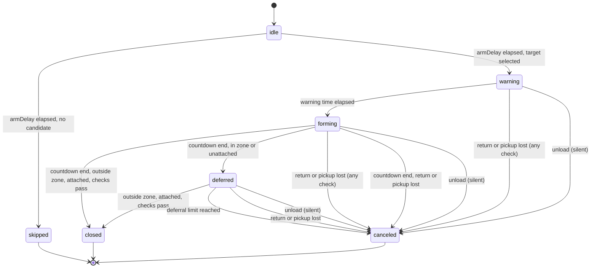

# Design Document

## Overview

Mission 1 ("echo") gets one scripted hazard. After the first survivor is boarded, the game picks one channel the player used on the way out, warns about it, shows it forming, and closes it. Before the warning and again before closing, a pure `routeCheck` confirms that the boat can still drive to the ranger station (Return_Route) and that the station can still drive to the dock (Pickup_Route, only while survivors remain ashore). "Drive" means the real game rules: sampled `waterClearance` at or above the hull threshold along the channel centerlines, not graph connectivity alone.

The design follows from reading the source (baseline `3ab7049`):

- `missions.mjs` exports `routes`, `landmarks`, `barriers`, `waterClearance`, `reachable`. All are DOM-free, so route logic can be tested in Node.
- `game.js` imports the DOM and cannot run in Node. All closure logic therefore goes in a new DOM-free module that returns *effects*. `game.js` only feeds it inputs and applies the effects.
- Mission 1 has no `closures` array. The existing block in `update()` (`updateClosures`, removal when `waterClearance < 8`) never runs for it, so the new event cannot reuse it. That check also fires when the boat is merely near any shore, not only near the barrier.
- Time stops while the chart or a dialog is open (`frame()` only calls `update()` while `controlsOn()`). Event timers use `state.elapsed`, so they stop too. This satisfies Requirement 6.3.
- `move()` in `game.js` lets the boat advance when `waterClearance(next, closed) >= 8`, or when it is already below 8 and the next point is no worse. The hull clearance threshold is therefore **8**. `waterClearance` returns `-Infinity` inside any closed barrier rectangle (`|along| < 16`, `|across| < barrier.width`), and otherwise the maximum over all channels of `radius - distance to segment`. A barrier rectangle therefore blocks every channel it overlaps, not only its own.

Scope: Mission 1 only. Existing voice clips are unchanged. The 19 closure clips are installed in `dist/assets/radio/` and are used as they are; no TTS is involved.

## Requirement updates needed

These follow from your decisions or from the source. They need your approval before `requirements.md` changes.

1. **Scope and clips (decisions 1, 2).** Remove the assumptions about test audio and the requirement to generate clips. Requirements 8.15 and 8.16 check that files exist and are non-empty. Audio length and wording are manual checks only.
2. **East-loop channels (decision 3).** Appendix C should say `outpost-run`, `east-bank`, `south-run` and `far-bend` stay usable as detours in the Return_Route and Pickup_Route graph but are not closure targets in this milestone. The "hard to show on the Chart" wording should go. Other excluded channels are also usable detours.
3. **Appendix B.** Replace the "Closable in" column with the table below once the PENDING Node check has run. The row set matches, but a "not impactful" note is added for dead ends (see Candidate selection). The check now also applies the drivable-path rule, so rows may be removed.
4. **Impactful candidate rule (new).** Requirement 2.1 and 3.x define a Safe_Closure_Candidate by route checks only. A closure on a dead end passes the check yet changes nothing for the player. Add: a candidate must also lengthen the shortest Return_Route from the boat (detour cost above zero).
5. **Selection timing (Requirements 5.3, 5.4).** The target is selected when the warning is announced (the arm delay after boarding), using the boat position at that moment. It is not selected at boarding.
6. **Arm delay (new constant).** Add `armDelay` (4 s) to Closure_Timing_Constants (Requirement 14). Boarding transmits `return-full`, `return-last` or `one-aboard` at priority 4, and a priority 5 warning would cut it off (see Radio priority).
7. **Caption format (Appendix A.2, Requirement 13.6).** `transmit(id, priority, place)` builds the caption as `Dispatch (<place>) · <text>`. The Shared_Clip captions will read `Dispatch (Cypress Slip) · The channel is closed. Check the map for another way back.` The Appendix A.2 Caption column should be updated to match, or the caption format changed. The registered line `text` must equal the spoken text, because the same `text` feeds the caption.
8. **Warning duration (Requirement 2.10).** The caption (priority 5 `announce`) lasts only about 3.3 s (`max(3.1, length/15)`). The persistent cue for the rest of the 20 s is the HUD `conditions` line plus the Chart and canvas cues. Add the HUD line to Requirement 2.11.
9. **Narrow channels (Requirement 3.5).** Every channel has radius 23 or more and the boat needs about 8 plus a 7 px half-width, so a width rule never excludes anything today. Reword 3.5 to the drivable-path rule (new item 12) and keep `minChannelRadius` as a guard.
10. **Cypress Slip assumption 4.** Confirmed. The slip's absolute points (x 1575 to 1753) agree with `low` (1569, 632) and `island` (1720, 329). Remove the "design should still confirm" wording.
11. **Countdown continues in the zone (Requirements 2.10, 3.9, 3.15, new wording).** Entering the Closure_Zone during the Warning_Phase or Forming_Phase does not pause, reset or cancel the countdown. The zone is tested only at the Countdown_End. Requirement 3.15 must say that only a lost Return_Route or Pickup_Route cancels during those phases, and that zone occupancy or failure to attach never does.
12. **Drivable water path (Requirements 3.1, 3.2, 3.4, 3.5, 3.6, 8.3 to 8.6).** Define a route as drivable when sampled `waterClearance` is at least the hull threshold of 8 along each centerline used, and across each junction node. Define boat attachment by a clear straight connection and the boat's side of the barrier. Add the reason `unattached`.
13. **Unattached is a deferral (Requirements 3.9, 3.14).** If the boat cannot attach to any channel, the route check fails with `unattached`. This is expected to clear, so it behaves like the zone: it defers at the Countdown_End and never cancels by itself. Requirement 3.14 ("a reason that does not involve the Closure_Zone") must list `unattached` with the zone as non-canceling reasons, with the Deferral_Limit as the only exit.
14. **Complete traversal tracking (Requirements 1.2 to 1.4).** Define the traversal rule by the entry zone, leaving it, the far end zone and the net progress threshold, with no speed or time limit. Define U-turns and sideways exits as "not recorded".
15. **Announcement staleness (new Requirement under 2 and 3).** A queued closure clip or caption must describe the current closure state when it starts, or it is dropped. A `closure-deferred` clip is announced only after the boat has stayed deferred for `minDeferredDwell`. This adds a constant to Closure_Timing_Constants (Requirement 14).
16. **Requirement 3.11 wording.** "Leave the boat's position and controls unchanged" reads as locking the boat. The design assumes the player keeps control. Confirm and reword to "the boat remains under player control".

## Open decisions (not yet answered; defaults kept)

| # | Decision | Default in this design |
| --- | --- | --- |
| A | Selection policy: smallest or largest detour | Smallest detour, ties by registry order |
| B | Add `package.json` with fast-check as a dev dependency | Yes, dev tooling only; `dist/` stays static |
| C | Warning timing after boarding | Fixed 4 s `armDelay`, not "wait for the boarding clip to end" |
| D | Pause discarding a clip | `voice.stop()` on pause discards the clip; it does not replay on resume |
| E | New: `minDeferredDwell` value | 2 s, to be tuned at the timing playtest (clip lengths are not decoded here) |
| F | New: unattached before the first warning | Defer arming and retry each check until `deferralLimit` after `armDelay`, then skip |

## Architecture



### Module layout (all under `dist/`, all `.mjs`, no DOM)

| File | Contents |
| --- | --- |
| `closure-config.mjs` | `CLOSURE_TIMING = { warning: 12, forming: 8, deferralLimit: 15, armDelay: 4, minDeferredDwell: 2 }`. `CLOSURE_GEOMETRY = { traversalThreshold: .6, endZone: .2, zoneMargin: 20, minChannelRadius: 15, hullClearance: 8, sampleStep: 12, attachStep: 6, nodeProbe: 12 }`. The only place these values appear as literals, except the `8` already in `game.js` `move()` (a test checks that the two agree). |
| `closure-registry.mjs` | `closureRegistry`: 16 entries `{ id, name, line }`, with `line = "closure-warning-" + id`. Also `sharedLines = { closed, canceled, deferred }` (ids `closure-closed`, `closure-canceled`, `closure-deferred`). |
| `closure.mjs` | Graph, drivability cache, `attachBoat`, `routeCheck`, traversal tracker, `selectTarget`, `createClosure`, `stepClosure`. |
| `radio-lines.mjs` | 16 warning lines and 3 shared lines added, as `dispatch(text)` with the Appendix A text. No existing line changes. |
| `radio.mjs` | Optional fourth argument `isCurrent` on `say`, and a small `dropStale()` method. Existing callers unchanged (see Announcement staleness). |
| `play-progress.mjs` | Add pure `applyFinishTime(times, id, time)`. `game.js` `recordFinish` calls it. |
| `map.mjs` | Add `drawClosureCue(c, cue)`. |
| `operator.mjs` | Add forming and deferred posts from a `closureCue` argument. |

Tests live in `tests/` and run with `node --test`. Property tests use fast-check as a dev dependency. The repo has no `package.json` yet, so one is added for dev tooling only (open decision B).

## Components and Interfaces

### Drivable water path

A point `p` is **drivable** under closed set `K` when `waterClearance(p.x, p.y, K) >= hullClearance` (8, the value `move()` uses). A barrier rectangle returns `-Infinity`, so any sample inside a closed barrier is not drivable, even when the barrier belongs to another channel.

The graph has the `landmarks` keys as nodes and `routes` as undirected edges. Each edge has a polyline length `L` and radius `r`.

- **Edge usable** under `K`: the edge is not in `K`, `r >= minChannelRadius`, and every sample along its polyline is drivable. Samples are placed every `sampleStep` (12 px, below the barrier's 32 px along-extent so no barrier can fall between two samples), and always at every polyline vertex and both ends.
- **Node usable** under `K`: the node point and 8 points on a ring of radius `nodeProbe` (12 px) around it are all drivable. Ring points are within 12 px of a centerline whose radius is at least 23, so a ring point fails only because a barrier covers it. This is deliberately strict: an unrelated barrier that overlaps a junction makes the node unusable. The strictness can only cause deferral or a skipped event, never a trapped boat.
- **Cache.** Edge and node usability depend only on `K`. They are cached by a key built from the sorted ids of `K` (`closedKey`). A run touches only a few keys (roadblocks, roadblocks plus candidate, plus the detour comparison), so the cache is small.

Route search (Dijkstra) uses only usable edges and passes only through usable nodes, including its start and end nodes.

### Boat attachment

The boat is not a graph node, so it must attach to the graph by a clear connection. `attachBoat(boat, K)` returns the list of `{ node, cost }` entries, or an empty list when no channel attaches.

For every channel, including closed ones and the candidate:

1. Find the nearest point `q` on the centerline (arc position `s`) and the distance `d`.
2. Sample the straight segment boat to `q` every `attachStep` (6 px), including both ends. The channel attaches only if **every sample is drivable** (clearance at or above 8) **and no sample lies in any closed barrier's Closure_Zone** (the zone of every channel in `K`).
3. From `q`, the boat can travel along the centerline toward each end, subject to the side rule below, and the traveled part (from `s` to that end) is sampled with the same drivable test.
4. Entry cost = `d` plus the arc length to that end node. The end node must be usable.

Side rule (replaces the old nearest-channel fallback): for a closed channel (an existing roadblock or the candidate) with barrier arc position `sb`, the boat reaches only the end on its own side: `s < sb` gives the `from` end, otherwise the `to` end. Because the connection segment may not cross a barrier zone, a boat cannot attach "through" a barrier to the far side. An open channel offers both ends.

If no channel attaches, `routeCheck` returns `reason: "unattached"`. There is no nearest-channel fallback. `unattached` is a **deferral reason**: it is expected to clear when the boat moves back into open water, so it never cancels by itself (see state machine). Examples: the boat is in the shallows, or inside the candidate's zone with no clear way out.

### Closure_Zone

In the barrier frame (same formulas as `waterClearance`): `|along| < 16 + zoneMargin` and `|across| < barrier.width + zoneMargin`. The margin is at least the hull half-length of 15 px (hull runs from -13 to +15). The zone therefore contains every position where `waterClearance` with the barrier active would be `-Infinity`, plus the boat's body.

### routeCheck

```js
routeCheck({ closed, candidate, boat, remaining, sites }) ->
  { ok, reason: "zone" | "unattached" | "return" | "pickup" | null,
    returnLength, detour }   // detour = returnLength(with candidate) - returnLength(without)

classify(reason) -> "defer" (zone, unattached) | "lost" (return, pickup) | null
```

1. `closedNext = closed ∪ {candidate}`.
2. If the boat is in the candidate's Closure_Zone, return `reason: "zone"`.
3. `attachBoat(boat, closedNext)`. If empty, return `reason: "unattached"`.
4. Return_Route: Dijkstra from the boat's attach entries to `station` over usable edges and nodes under `closedNext`. None found gives `reason: "return"`.
5. If `remaining > 0`: Pickup_Route from `station` to every site node in `sites` that still has survivors (for Mission 1: `island`), over usable edges and nodes under `closedNext`. None found gives `reason: "pickup"`. If `remaining === 0`, skip this step.
6. `ok` only if both required routes exist. `detour` is used for selection.

The function does not read `Math.random` or the clock. The caller treats `classify(reason)` as follows:

| Moment | `defer` reasons (zone, unattached) | `lost` reasons (return, pickup) |
| --- | --- | --- |
| Before the warning | Candidate not eligible now; retry (open decision F) | Candidate not eligible |
| Warning or Forming phase | Ignored (no cancel, no pause) | Cancel |
| Countdown_End | Enter deferred | Cancel |
| Deferred | Keep waiting | Cancel |

### Traversal tracker

State per registry channel: `{ entryEnd: null | "from" | "to", entryPos: { s, x, y } | null, entered: boolean, leftEntryZone: boolean, maxProgress: number }`, plus `record: string[]` in first-traversal order.

Each frame during the Outbound_Leg, the tracker updates **each registry channel independently**. Channels that share an end node are therefore handled separately: a boat at a junction is inside several channels and each keeps its own state. Distances are measured along each channel's own arc, never by node.

For one channel, let `inside` be "polyline distance below the channel radius", `s` the arc position of the nearest point, `L` the length, and `u = s / L`. The entry zone is the end zone where it entered, and "end zone" means `u <= endZone` (from end) or `u >= 1 - endZone` (to end). Progress `p` is the net arc advance away from `entryPos.s`, as a fraction of `L`: `p = (s - entryPos.s) / L` for entry at `from`, `(entryPos.s - s) / L` for entry at `to`.

| Situation | Action |
| --- | --- |
| Not inside, and `entered` | Sideways or end exit: clear the state (not recorded). |
| Inside, not `entered`, boat in an end zone | Start: `entered = true`, `entryEnd` set, `entryPos = { s, x, y }`, `leftEntryZone = false`, `maxProgress = 0`. |
| Inside, not `entered`, boat mid-channel | Nothing. Joining from the side never starts a traversal. |
| (i) `entered`, boat still in the entry zone, `leftEntryZone = false` | No change. The traversal stays pending, however long the boat idles. |
| (ii) `entered`, boat outside the entry zone | `leftEntryZone = true`; `maxProgress = max(maxProgress, p)`. Backward wiggles inside the channel change nothing. |
| (iii) `entered`, `leftEntryZone`, boat back in the entry zone | U-turn: clear the state (not recorded). |
| (iv) `entered`, boat in the far end zone, `p >= traversalThreshold` | Add the channel to `record` once and clear the state. |

There is no speed or time limit. A slow crossing with pauses and small backward steps is recorded exactly like a fast one, because the rules depend only on position. A boat entering from the far end is the mirror case (`entryEnd = "to"`) and is recorded the same way. With `endZone = .2` and `traversalThreshold = .6`, a boat that enters at the zone edge (`u = .2`) and reaches the far zone edge (`u = .8`) just meets the threshold.

Tracking stops when `aboard` first becomes greater than 0. The tracker is skipped for channels that are starting roadblocks of the setup, for `launch-channel`, and for any channel not in the registry. The boat's per-frame step is at most about 2.4 px (140 px/s), far below the zone width, so no end zone is skipped between frames.

### Candidate selection

`selectTarget({ record, closed, boat, remaining, sites })`:

1. Take the registry channels in `record`, not in `closed`.
2. Keep those where `routeCheck(...).ok` and `detour > 0` (the Impactful rule). A candidate that fails with a `defer` reason is not eligible for this call.
3. Choose the smallest `detour`. Ties go to registry order.
4. If none remain, return `{ target: null, deferOnly }`. `deferOnly` is true when every failure was a `defer` reason. The event then stays `idle` and retries on the next check until `armDelay + deferralLimit` after boarding, then goes to `skipped` (open decision F). Otherwise it goes to `skipped` at once.

The result depends only on the setup, the record, and the boat position. Smallest detour keeps the closure fair while still changing the route. This policy is open decision A.

### Closure state machine

The countdown starts when the warning is announced and runs for `warning + forming` seconds. It is never paused, reset or canceled because of the boat's position relative to the Closure_Zone, nor because the boat is unattached.



`idle` holds `armedAt` (set when `aboard` first exceeds 0). `closed`, `canceled` and `skipped` are terminal. At most one event runs per run. Every phase change increments `epoch` (used by the staleness guard).

Transition table:

| From | Condition | To | Notes |
| --- | --- | --- | --- |
| idle | `elapsed >= armedAt + armDelay`, `selectTarget` returns a target | warning | `countdownStart = elapsed` |
| idle | no target and not `deferOnly`, or `deferOnly` past its limit | skipped | no clip |
| warning | `elapsed >= countdownStart + warning` | forming | zone state ignored |
| warning, forming | periodic check (0.25 s) gives `return` or `pickup` | canceled | `closure-canceled` clip |
| warning, forming | periodic check gives `zone` or `unattached` | unchanged | countdown keeps running |
| forming | `elapsed >= countdownStart + warning + forming`, check ok | closed | `close` effect |
| forming | countdown end, check gives `zone` or `unattached` | deferred | `deferredAt = elapsed` |
| forming | countdown end, check gives `return` or `pickup` | canceled | `closure-canceled` clip |
| deferred | check ok (boat outside zone and attached) | closed | `close` effect |
| deferred | check gives `return` or `pickup` | canceled | `closure-canceled` clip |
| deferred | `elapsed - deferredAt >= deferralLimit` | canceled | `closure-canceled` clip |
| warning, forming, deferred | `aboard` goes to 0 | canceled | silent |

```js
stepClosure(event, { elapsed, boat, aboard, remaining, sites, closed }) ->
  { event, effects: [ { type: "transmit", id, place, phase, epoch } | { type: "close", id } | { type: "cue", stage, id } ... ] }
```

Inputs come from `state` and `boat` in `game.js`. The step runs `routeCheck` on a 0.25 s cadence during `warning`, `forming` and `deferred`, and at the countdown end. Effects:

| Transition | Effects |
| --- | --- |
| idle to warning | `transmit(line, 5, name)` with `phase: "warning"`, cue `warning` |
| warning to forming | cue `forming` (progress grows over the forming time) |
| forming or deferred to closed | `close` (game adds the id to `state.closed`), `transmit("closure-closed", 5, name)` with `phase: "closed"`, cue `closed`, tone 152 as `cut-closed` does |
| forming to deferred | cue `deferred` at once. The `transmit("closure-deferred", ...)` effect is emitted once, only when `elapsed >= deferredAt + minDeferredDwell` and the phase is still `deferred` |
| any active to canceled (lost route or limit) | `transmit("closure-canceled", 5, name)` with `phase: "canceled"`, cue cleared |
| any active to canceled (unload) | cue cleared, no clip |
| idle to skipped | none |

If the boat leaves the zone and the check passes before `minDeferredDwell`, the event goes straight to `closed` and `closure-deferred` is never announced. The cue and HUD line show `deferred` meanwhile, so the player is never without information.

Unload is detected as `aboard` going to 0 with the event active. The event never starts for Mission 1 outside the echo mission with a route setup. For other missions `createClosure` returns an inactive event whose step returns no effects.

### Announcement staleness guard

Problem: `RadioVoice` has one pending slot, and a line queued at equal or lower priority plays when the current clip ends (`ended` calls `say`). A `closure-deferred` clip could therefore start after the channel has closed, and a warning could start after a cancel. The caption has a similar risk, since `announce` keeps `message` for up to its duration.

Design:

1. **Token.** Each closure `transmit` effect carries `phase` and `epoch` (the event's `epoch` at the moment the effect was produced). `game.js` builds `isCurrent = () => closure === event && event.epoch === epoch`, where `event` is the event object that produced the effect. `closure === event` also drops lines from a previous run after Retry. Because `epoch` changes at every phase change, the predicate is true only while the state the line describes is still the current one. Terminal phases never change epoch again, so the `closed` and `canceled` lines stay valid.
2. **`radio.mjs` change (minimal, backward compatible).** `say(id, priority, pan = 0, isCurrent = null)`. The predicate is stored in the pending entry and on the playing request. It is checked in three places: at entry to `say` (drop when false), when a queued entry is taken in `ended` (the `say(next...)` call already runs the first check), and after the buffer has loaded and just before `source.start()`. Callers that pass three arguments see no change, because a missing predicate means "always current". A new `dropStale()` stops the current clip when its predicate now returns false; `game.js` calls it before a closure `say`, so a superseded closure clip is cut and the new line plays at once instead of queuing behind it at equal priority.
3. **Caption.** `announce` gets an optional fifth argument, the same predicate, stored as `messageCurrent`. `caption()` returns `message` only while `messageCurrent` is absent or true. Closure transmits replace the previous caption anyway (equal priority 5 replaces), so this only removes a leftover caption of a superseded state. Result: the caption always names the current state or is empty.
4. **Minimum deferred dwell.** The `closure-deferred` line is emitted only after `minDeferredDwell` (2 s) of continuous deferral. A boat that clears the zone quickly closes the channel without the deferred line. Together with the predicate, a deferred clip cannot play after `closed` or `canceled`.
5. **Single pending slot.** Warning to closed are never closer than the dwell, and the predicate drops any entry that became stale, so a replaced or stale entry is not a correctness problem.

### Integration points in game.js

| Place | Change |
| --- | --- |
| `start()` | `closure = createClosure(mission())`. Warm the three shared clips and, once the target is known, its warning clip via `voice.warm(id).catch(() => {})`. |
| `update()` | After `move(dt)`: call `stepClosure`, then apply effects. `close` does `state.closed.add(id)` directly, only when the step has found the boat outside the Closure_Zone and attached. The existing `closedHere` removal is not involved because it sits inside the `newClosures.length` branch that Mission 1 never enters. |
| `transmit` / `announce` | `transmit` and `announce` gain an optional `isCurrent`. Closure effects call `voice.dropStale()` and then `transmit(id, 5, name, isCurrent)`. All other callers are unchanged. |
| `caption()` | Honors `messageCurrent` as described above. |
| `state.closed` | Adding the target makes `wrongWayApproach`, `waterClearance`, `drawClosures` and the operator posts treat it like any roadblock. The Lantern_Keeper (2.5 s delay, 22 s cooldown) works with no change. While the target is open it is not in `state.closed`, so the keeper stays hidden. |
| `updateHUD` | `conditions` shows `<Name> closing in m:ss`, `forming`, `deferred` or `<Name> closed`, in the same style as `upcoming`. The closed names list also includes the target's name. |
| `drawChartLabels` | Add a label for the cue (`<Name> · closing`, `forming`, `deferred`, then `closed` through the existing blocked label list). |
| `draw()` | Call `drawClosureCue(ctx, cue)` next to `drawClosures` in the overhead and chart path. The operator receives `closureCue` and adds amber posts (count grows with forming progress), plus the floor cue. |
| `recordFinish` | Call `applyFinishTime`. |

Chart and overhead share the world-space drawing, so one cue draw covers both. The operator needs its own posts.

### Radio priority

Priority use in the current source:

| Priority | Lines |
| --- | --- |
| 1 | Ambient survivor and keeper calls (`radio()`) |
| 2 | `one-aboard`, shallow-water captions |
| 3 | Briefings, `keeper-reveal` |
| 4 | `confirmed`, `return-more`, `return-full`, `return-last` |
| 5 | `cut-warning`, `flood-warning`, `cut-closed`, `storm-closed`, `wrong-way` |
| 6 | `complete`, `failed`, `finale`, final delivery caption |

`RadioVoice.say` behavior:

- A new line preempts only when its priority is strictly higher than the current one. `stop()` also clears the single pending slot.
- Equal or lower priority is dropped below 3. At 3 or above it goes into one pending slot, and a newer entry of equal or higher priority replaces an older one.
- A queued line plays when the current clip ends.
- `announce` follows the same rule for captions, with equal priority replacing the current caption.

Findings:

1. Priority 5 is right for all 20 new lines. It matches the existing closure announcements and preempts ambient calls and `confirmed` and return lines. Only priority 6 can cut a closure clip.
2. Boarding transmits a priority 4 line at the same moment the event arms. A priority 5 warning on the same frame would cut it off and replace its caption. The `armDelay` of 4 s avoids this (open decision C).
3. Equal priority does not preempt. A `wrong-way` clip (priority 5) playing when a closure line is due makes the closure line wait in the pending slot, about 2 s. The staleness guard drops it if the state moved on in the meantime. The caption still replaces at once.
4. Pending holds one line. If two closure lines were queued, the later would replace the earlier. With `minDeferredDwell` and the guard, a stale entry is never played.
5. A warning is dropped silently only if sound is off or the clip fails to load. The caption, HUD line and cues still show.
6. Pausing calls `voice.stop()`, which discards a playing or pending clip. The cue stays visible and the clip does not replay after resume (open decision D).

### Clip handling and concerns

All 19 files are installed in `dist/assets/radio/` (16 `closure-warning-*` plus `closure-closed`, `closure-canceled`, `closure-deferred`) and are used as they are. The 16 ids match the registry.

- Automated: each file exists and is non-empty. Each registry line is registered in `radio-lines.mjs` with non-empty text that contains the Display_Name. Shared lines are registered.
- Manual (not automated, since no audio is decoded): each clip names the same channel as its caption, fits within 5 s, and the three shared clips match the wording in Appendix A. The length of `closure-deferred` also tunes `minDeferredDwell`.
- Concern: the files were not decoded for this design, so lengths and wording are unchecked. If a recording differs from Appendix A, update the `radio-lines.mjs` text so the caption matches the voice.
- Concern: the first `say` for an id fetches and decodes the file. Warming the target's clip and the shared clips avoids a late start. A failed load goes to `ended` and the caption path continues (caption-only fallback).
- `RadioVoice` uses `assets/radio/<id>.mp3`, so the line id must equal the file base name. The registry enforces this.

## Data Models

```js
// closure-registry.mjs
{ id: "cypress-slip", name: "Cypress Slip", line: "closure-warning-cypress-slip" }

// event
{ active: boolean, phase: "idle"|"warning"|"forming"|"deferred"|"closed"|"canceled"|"skipped",
  epoch: number,                       // increments at every phase change
  armedAt: number|null, target: string|null, countdownStart: number|null,
  phaseStart: number, deferredAt: number|null, deferredAnnounced: boolean,
  nextCheck: number, record: string[],
  tracker: Map<string, { entryEnd: "from"|"to"|null,
                         entryPos: { s: number, x: number, y: number }|null,
                         entered: boolean, leftEntryZone: boolean, maxProgress: number }>,
  outboundDone: boolean }

// cue (read by drawing code)
{ id, name, stage: "warning"|"forming"|"deferred"|"closed", progress: 0..1 }

// usability cache, keyed by closedKey = sorted closed ids joined
{ edges: Map<string, boolean>, nodes: Map<string, boolean> }
```

The saved record format is unchanged: `{ "echo:reed-narrows": 1234, ... }` in tenths of a second.

### Closable-in table (provisional)

Derived by tracing `routes`, `landmarks` and `roadblocks` for each setup and closing one channel at a time. A channel is closable when station-to-dock stays connected, it is not a roadblock, and it lies on a path the player could use (not a dead end). RN is Reed Narrows (closed: cypress-creek, cypress-slip). NA is North Approach (closed: reed-squeeze, cut). SC is South Crossover (closed: north-inlet, high-water, cut).

| Channel | Closable in | Reason when excluded |
| --- | --- | --- |
| cypress-creek | NA, SC | RN roadblock |
| cypress-squeeze | NA, SC | RN dead end (cypress-creek blocked) |
| high-marsh | RN, SC | NA only link to Cypress Exit |
| fallen-cypress | RN, SC | NA only link to Cypress Exit |
| north-passage | RN, NA | SC dead end (north-inlet blocked) |
| north-inlet | RN, NA | SC roadblock |
| reed-bend | NA, SC | RN only link south |
| mud-bend | NA, SC | RN only link south |
| reed-squeeze | RN, SC | NA roadblock |
| cross-marsh | RN, NA, SC | none |
| east-crossover | RN, NA, SC | none |
| willow-reach | RN, NA | SC only link to south inlet |
| south-inlet | RN, NA | SC only entry to the sector |
| cut | RN | NA and SC roadblock |
| high-water | RN, NA | SC roadblock |
| cypress-slip | NA, SC | RN roadblock |

**Discrepancies from requirements Appendix B:** none in the Closable-in column. All 16 rows match. Differences are in reasoning and in what the table means:

- `cypress-squeeze` in RN and `north-passage` in SC are route-safe (closing a dead end disconnects nothing). They are excluded by the new Impactful rule, not by the route check. Appendix B's notes call them "dead end" but do not say which rule excludes them.
- In SC, `cypress-slip` is closable only because the east loop (`south-run`, `far-bend`, `east-bank`, `outpost-run`) stays open as a detour. That depends on decision 3.
- `old-landing-run` is a bridge to `low` in SC (the island is reachable only through `low`). It is excluded from the registry, which matches Appendix C.
- Requirement 3.5 (narrow channels) never excludes any channel on width alone (see update 9).

**Status: PENDING.** The graph tracing above is by hand. It ignores the drivable-path rule, so it is an upper bound. A Node check must confirm it with the real hull threshold and barrier geometry. For each setup and candidate it runs the production `routeCheck` and compares with the hand table:

1. station-to-dock and boat-to-station connectivity with the candidate closed;
2. every edge and junction node on the chosen detour is usable under the closed set plus the candidate (sampled `waterClearance >= 8`), so a barrier that overlaps an unrelated channel or a node removes that edge or node, and a row that depended on it is removed;
3. boats placed on both sides of the barrier, at the zone edge, inside the zone (`zone`), and in the shallows (`unattached`).

Until it passes, the table is provisional and any row that fails is removed from the registry for that setup.

## Correctness Properties

*A property is a characteristic or behavior that should hold true across all valid executions of a system-essentially, a formal statement about what the system should do. Properties serve as the bridge between human-readable specifications and machine-verifiable correctness guarantees.*

Reflection: the Return_Route and Pickup_Route soundness properties merge into one oracle property. The determinism and membership properties on selection merge. Separate properties for "closes only when outside zone" and "deferral never exceeds the limit" merge into one state machine safety property. Timing is kept separate because it is a different quantity. The staleness property is separate because it concerns the radio layer, not the state machine.

### Property 1: Route check agrees with a drivable-path oracle

For any Mission 1 route setup, any registry channel as candidate, any boat position (both sides of the barrier, inside the Closure_Zone, at its edge, in the shallows, and off the candidate channel) and any remaining count, `routeCheck` passes exactly when the boat is outside the Closure_Zone, attaches to some channel by a clear connection, and an independent exhaustive search finds a Return_Route from the boat to the station and, while remaining is above zero, a Pickup_Route from the station to the dock. The oracle uses only its own sampling of `waterClearance(x, y, closed ∪ {candidate}) >= 8` along channel centerlines, across junction nodes, and along the boat's straight connection, and treats the closed channels and the candidate as unusable. When it fails, `reason` is `zone` for a boat in the zone, else `unattached` when no channel attaches, else `return` or `pickup`.

**Validates: Requirements 3.1, 3.2, 3.4, 3.5, 3.6, 8.3, 8.5, 8.6**

### Property 2: Returned routes are drivable and avoid closed channels and the zone

For any setup, candidate and boat position where `routeCheck` passes, every edge of the returned Return_Route and Pickup_Route is open, not the candidate, and every sampled point on it, and every node on it, has `waterClearance >= 8` under the closed set plus the candidate. The boat's attach connection has `waterClearance >= 8` at every sample and crosses no closed barrier zone. The Return_Route start is on the boat's side of any barrier on its own channel.

**Validates: Requirements 3.4, 3.6, 8.4**

### Property 3: Pickup check is skipped when no survivors remain

For any setup, candidate and boat position, with remaining equal to zero the check result equals the Return_Route result alone.

**Validates: Requirements 3.3, 8.7**

### Property 4: Target selection is deterministic and safe

For any setup, traversal record and boat position, `selectTarget` returns the same result on repeated calls. The result is either null or a registry channel that is in the record, is not a starting roadblock, passes `routeCheck` with a positive detour, and has the smallest detour (ties by registry order). Null leads to the `skipped` state, or to a retry when every failure was `zone` or `unattached`.

**Validates: Requirements 2.1, 2.3, 3.18, 5.3, 5.4, 8.9**

### Property 5: Traversal record membership and set semantics

For any sequence of boat positions along and around registry channels, including arbitrary step sizes, pauses, repeated positions and small backward steps, a channel is in the record exactly when the sequence contains a start in one end zone of that channel, a later position outside that entry zone, and then a position in the opposite end zone with net progress from the entry position of at least `traversalThreshold`, with no position back in the entry zone after the entry zone was left and no position outside the channel in between. Sequences that idle in the entry zone and leave through it, that leave the entry zone and return to it (U-turn), or that leave the channel sideways are not recorded. The result is independent of the number of steps and of elapsed time, and entering from either end gives the same result. Channels sharing an end node are tracked independently, so a crossing recorded for one channel does not change another. Repeating a traversal leaves the record unchanged. Roadblock channels and `launch-channel` are never recorded.

**Validates: Requirements 1.2, 1.3, 1.4, 1.5, 1.6, 1.7, 8.8**

### Property 6: Closure state machine safety

For any sequence of inputs (boat positions, `aboard`, `remaining`, elapsed steps), the event adds a channel to `closed` at most once per run, only while the boat is outside the Closure_Zone and `routeCheck` passes at that step, and never in a terminal state afterwards. The event never cancels for a `zone` or `unattached` result before the Countdown_End. Time spent in `deferred` never exceeds the deferral limit, and a deferred event that exceeds it is canceled. Unload while active produces `canceled` without a `closure-canceled` effect.

**Validates: Requirements 2.2, 3.8, 3.9, 3.12, 3.13, 3.14, 3.15, 3.17, 3.19, 8.11**

### Property 7: Countdown duration is independent of zone occupancy

For any sequence of boat positions and zone or attachment states in which no `return` or `pickup` failure occurs, the time from the warning effect to the Countdown_End decision (`closed` or `deferred`) equals `warning + forming` from `CLOSURE_TIMING`, to within one step, regardless of when or how long the boat is in the Closure_Zone or unattached during that interval. The warning-to-forming switch occurs at `warning` seconds after the warning effect under the same condition. The result is `closed` if the boat is outside the zone and attached at the Countdown_End, otherwise `deferred`.

**Validates: Requirements 2.10, 3.9, 14.3, 14.4**

### Property 8: Best time is saved only when first or strictly faster

For any existing record map, record id and positive integer finish time, `applyFinishTime` returns a map where the id holds the finish time exactly when the id was absent or the finish time is strictly lower, and the map is otherwise unchanged. No other id changes.

**Validates: Requirements 5.8, 5.9, 5.10**

### Property 9: Record storage round trip

For any map of record ids to positive integers, `loadBestTimes` after `saveBestTimes` returns the same map. The legacy `echo` value migrates to `echo:reed-narrows` when that key is absent.

**Validates: Requirements 5.7, 9.6**

### Property 10: Other missions never run a closure

For any mission other than Mission 1 (training patrol, blackout, closing-cut, two-calls, last-crossing) and any input sequence, the closure step returns no effects and leaves `state.closed` unchanged.

**Validates: Requirements 9.1, 9.2, 12.1**

### Property 11: Played announcements match the closure state

For any sequence of closure transmits, phase changes and clip-end events, a closure clip starts playing, and a closure caption is shown, only when the closure event's current `epoch` equals the `epoch` the line carried. A `closure-deferred` line never starts after the phase became `closed` or `canceled`, a warning line never starts after `canceled`, and a closure line from an earlier run never starts. A deferred period shorter than `minDeferredDwell` never produces a `closure-deferred` effect. Calls to `say` without a predicate behave exactly as before.

**Validates: Requirements 2.12, 3.10, 3.16, 3.20, 13.8, 15.5**

## Error Handling

- Missing or failing clip: `voice.say` swallows the load error and the caption, HUD line and cues still show. The event continues.
- Missing registry entry or line: `createClosure` skips channels with no name or no registered line (Requirement 1.10). Tests fail if one is missing.
- No safe candidate: `skipped`, no warning. If every candidate failed only because the boat was in a zone or unattached, the event waits and retries until `armDelay + deferralLimit`, then skips.
- Boat off the channels (bumped into shallows): there is no nearest-channel fallback. If no channel attaches by a clear connection, the check returns `unattached`, which defers (it never cancels by itself). The player can steer back to open water and the check recovers.
- Boat in the zone or unattached during the warning or forming time: the countdown continues; only the Countdown_End decision uses the zone.
- Route check fails with `return` or `pickup`: `canceled`. Any `zone` or `unattached` failure leads to `deferred` at the Countdown_End and to `canceled` only at the deferral limit.
- A stale queued clip or caption: dropped by the `isCurrent` predicate.
- Chart or dialog open: timers pause with `state.elapsed`.
- `saveBestTimes` failure: existing behavior (record kept for the session, `recordSaved` false).

## Testing Strategy

PBT applies to the route check, selection, traversal, state machine, staleness guard and record logic, which are pure or run with stubs. It does not apply to canvas drawing or audio output; those use examples and manual checks.

### Property tests (Node, `node --test`, fast-check)

- One property test per property above, at least 100 runs each.
- Tag format: `Feature: dynamic-return-route-closure, Property N: <title>`.
- The oracle for Properties 1 and 2 is a separate exhaustive path search written in the test, with its own sampling of `waterClearance`, not the production Dijkstra or cache.
- Property 11 runs `RadioVoice` with a stubbed audio context (see the radio tests below).

### Unit and example tests (Node, no browser)

- Registry: 16 entries, each with a Display_Name, a line in `lines` with non-empty text containing the name, and an existing non-empty `dist/assets/radio/<line>.mp3`. Shared lines registered and files non-empty.
- Constants: `CLOSURE_TIMING` holds the five values. `hullClearance` equals the literal in `game.js` `move()`. No other `dist/*.mjs` or `game.js` repeats the timing values as literals (grep test).
- Closable-in table: for each setup and registry channel, `routeCheck` with the boat at the dock matches the table (this is the PENDING check).
- Drivable path: for each passing setup and candidate, sampled centerline points and junction probes of every edge and node on the chosen route have `waterClearance >= 8` with the candidate closed. A synthetic barrier overlapping an unrelated channel makes that edge unusable, and one overlapping a junction makes that node unusable. The usability cache returns identical results for a repeated closed-set key and different results for a different key.
- Attachment: a boat connected to a channel by a clear segment attaches. A boat behind a closed barrier zone, on the wrong side, or in the shallows gives `unattached`. A boat on the near side of the candidate attaches only to its own side.
- Deferral: boat in zone at countdown end enters `deferred`, closes after leaving, cancels at 15 s, cancels on unload. An `unattached` result at the countdown end defers (not cancels).
- Countdown in the zone: the boat enters the zone before zero, stays through zero (state `deferred`, no cancel, no reset), then steers clear: both routes are rechecked and the channel closes. Variants: the boat clears the zone before zero (closes on time at `warning + forming`), and the boat stays past `deferralLimit` (canceled with the `closure-canceled` effect). A further variant: a `return` failure while in the zone is not evaluated, so no cancel occurs until the check can attach.
- Periodic checks: a `zone` or `unattached` result in warning or forming never cancels; a `return` or `pickup` result cancels.
- Traversal tracker (examples):
  - slow full crossing: many tiny steps, pauses and small backward wiggles inside the channel are recorded once;
  - a U-turn after leaving the entry zone (back into the entry zone) is not recorded;
  - idling in the entry zone and then leaving back out through it is not recorded;
  - entering from the far end and crossing is recorded;
  - leaving the channel sideways mid-way clears the state;
  - two channels sharing an end node are tracked independently, and a crossing from one into the other records the first.
- Lantern Keeper: with the target in `closed`, `updateGhostWarning` appears after 2.5 s of advance, clears on turn away, 22 s cooldown. With the target open, no warning.
- Radio with a stubbed `RadioVoice` and audio context (the test seeds `voice.files` with resolved buffers and sets `voice.context` to a fake with `createBufferSource` and `decodeAudioData`, so no network or DOM is needed):
  - a priority 5 line queues behind another priority 5 line and preempts priority 4;
  - a queued announcement matches the closure state when it starts (predicate true: plays);
  - a stale `closure-deferred` queued behind another clip is dropped when the event closed first;
  - a stale warning queued behind another clip is dropped when the event was canceled first;
  - a clip that became stale while its buffer loaded does not start;
  - `dropStale()` cuts a playing superseded closure clip so the new closure line plays at once;
  - a three-argument `say` call (no predicate) behaves as before;
  - the caption shows the current state: after warning then cancel, the caption is the canceled line, not the warning; a leftover caption of a superseded state is not returned by `caption()`;
  - deferred then closed within `minDeferredDwell`: no `closure-deferred` effect is produced.
- Detours: the slip detour in North Approach and South Crossover, and the east loop detour in South Crossover.

### Regression suite

- `createState` output for all missions equals a stored baseline snapshot.
- `updateClosures` outputs for Closing Cut (time 65) and Last Crossing (`delivered` triggers) match baseline.
- All existing radio line ids and their files are unchanged (id list and file list snapshot).
- Existing `RadioVoice` behavior with three-argument `say` is unchanged (queue, replace, preempt, `stop`).
- Training patrol and the four other missions create an inactive closure (Property 10).
- `loadBestTimes` and `saveBestTimes` match baseline behavior.

### Kiro hook

`.kiro/hooks/route-check-suite.json` with a `PostFileSave` trigger. The matcher covers `dist/missions.mjs`, `dist/play-progress.mjs`, `dist/radio-lines.mjs`, `dist/radio.mjs`, `dist/closure.mjs`, `dist/closure-registry.mjs` and `dist/closure-config.mjs`. The action runs `node --test tests/`. A non-zero exit reports the failing output.

### Best-time logic

Today `recordFinish` in `game.js` already saves only when no record exists or `time < bestTimes[id]` (it returns early when `bestTimes[id] && time >= bestTimes[id]`). `play-progress.mjs` holds only `loadBestTimes` (with the legacy `echo` migration), `saveBestTimes` and `formatRunTime`. No change in behavior is needed. The implementation moves the comparison into `applyFinishTime` so it can be tested in Node. `recordFinish` stays guarded by `practice`, and is only reached after the last unload, so failed or abandoned runs and Retry or New_Run never write.

### Manual checklist

Automated results (Node suite, hook output) are reported separately from device playtests. Each row has fields for device, browser, date and pass or fail.

| Test | Desktop | iPhone Safari |
| --- | --- | --- |
| Complete all three route setups | yes | yes |
| Drive two different outbound routes; warning targets differ | yes | yes |
| Enter the zone during the countdown and stay past zero; the countdown does not pause, and the deferred line plays | yes | yes |
| Wait in the passage as the countdown ends, on both sides of the barrier | yes | yes |
| Leave the zone within 2 s of deferral; the channel closes with no deferred line | yes | yes |
| Stay in the zone past 15 s; channel stays open and cancels | yes | yes |
| Drive toward the closed channel, then take the detour; keeper appears and clears | yes | yes |
| Retry and New_Run; record unchanged unless strictly faster | yes | yes |
| Overhead, Operator and Chart, sound on and muted | yes | yes |
| No closure clip or caption plays after its state has ended (warning after cancel, deferred after closed) | yes | yes |
| Each warning clip names its caption's channel and ends within 5 s | yes | yes |
| Shared clips match Appendix A wording; reconcile captions if not | yes | yes |
| Remove one warning clip file; the game continues with captions | yes | no |
| Timing playtest; record final warning, forming, deferral and dwell values | yes | yes |
| Audio starts after an iOS tap (unlock) and plays the warning | no | yes |
